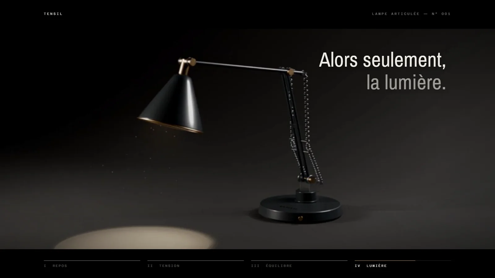
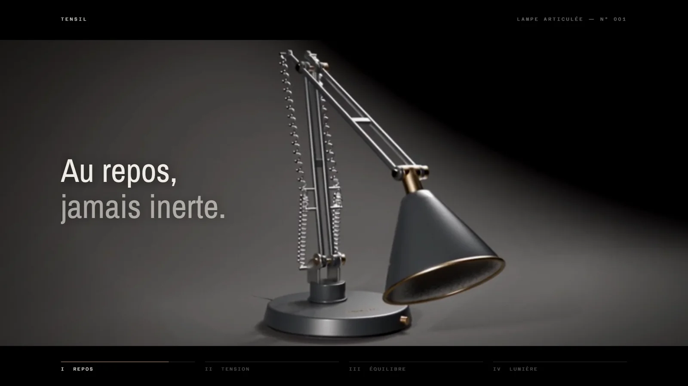
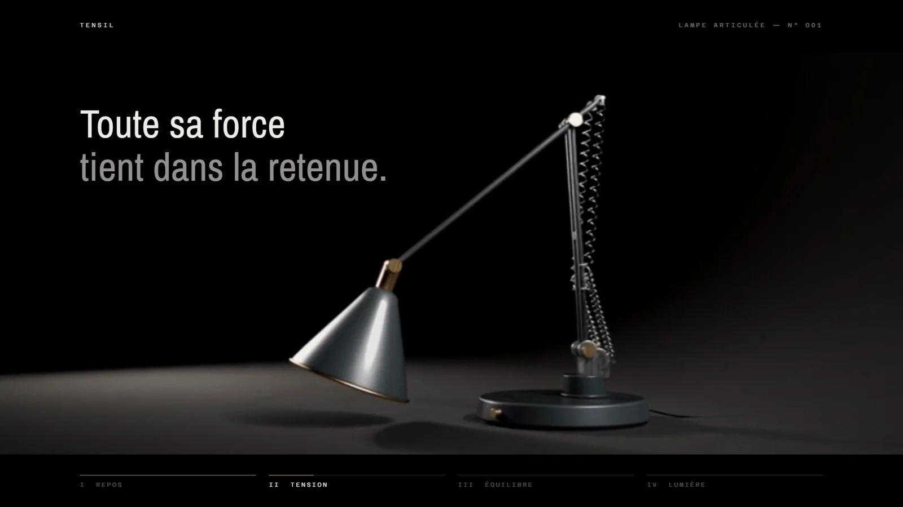
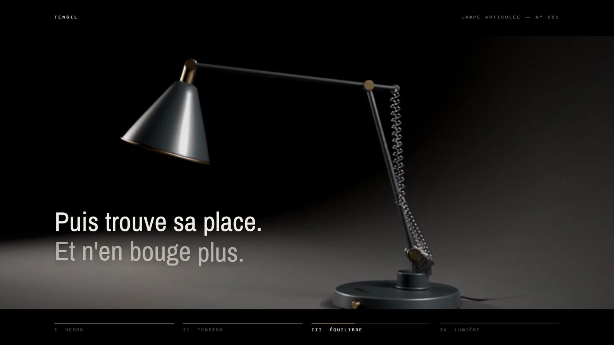
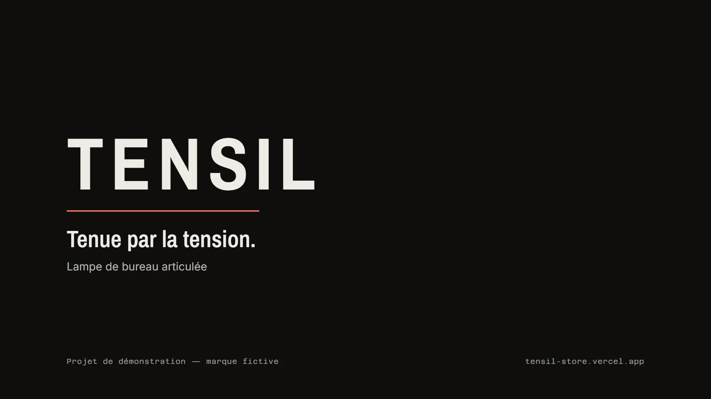

# TENSION — teaser de 30 s pour la lampe TENSIL

> Statut : **livré** le 2026-10-17. Marque fictive, projet de démonstration pour le portfolio.



## 1. But du projet
Réaliser un teaser publicitaire de 30 s, dans les codes d'une marque de luxe, pour **TENSIL**, la lampe de bureau articulée modélisée dans [blender-studio-object](https://github.com/elie-gordo/blender-studio-object). Le film raconte une histoire en quatre chapitres : la lampe au repos, la tension des ressorts, l'équilibre trouvé, puis la lumière.

Il démontre une chaîne de production **hybride** : une préviz Blender sert de référence de mouvement à un modèle vidéo IA (Seedance 2.5), les plans macro sont rendus en 3D, et le montage, le motion design et le son sont écrits en code.

Projet réalisé en **duo humain + IA** :
- **Elliott Lanza** : concept « TENSION », storyboard, choix du budget et des versions, ligne de fin, direction du motion design, validation de chaque étape.
- **Claude (Anthropic, via Claude Code)** : scripts Blender, préparation et lancement des générations Seedance, montage et motion design Remotion, synthèse du son, contrôles et documentation.

## 2. Le film
| Temps | Chapitre | Plans | Texte à l'écran |
|---|---|---|---|
| 0–1,5 s | prologue | P1 (noir) | « Certains objets attendent. » |
| 1,5–10 s | **I · Repos** | P02 ressort, P03 pivot, P04 lampe pliée | annotations « 01 — Ressort », « 02 — Pivot » ; « Au repos, jamais inerte. » |
| 10–18 s | **II · Tension** | P05 le bras se lève, P06 ressort, P07 la tête bascule | « Toute sa force tient dans la retenue. » ; « 03 — Tension » ; « Elle cède. » |
| 18–23,5 s | **III · Équilibre** | P08 pose de travail, P09 bouton | « Puis trouve sa place. Et n'en bouge plus. » ; « 04 — Interrupteur » |
| 23,5–28 s | **IV · Lumière** | P10 allumage, fin ralentie | « Alors seulement, la lumière. » |
| 28–30 s | fin | P11 | TENSIL — « Tenue par la tension. » |

Les caractéristiques des annotations (42 spires, laiton tourné…) sont inventées pour le récit, comme la marque.

## 3. Ce qu'il démontre
- **Préviz au service de l'IA :** chaque plan Seedance reçoit la vidéo de préviz Blender (caméra et timing), une image de début, une image de fin et les rendus produit. Le prompt interdit l'image en miroir et toute modification de la lampe.
- **Pipeline hybride maîtrisé :** 4 plans macro en EEVEE, 5 plans en IA, mêmes caméras et même timeline à 30 i/s (`blender/film.py`).
- **Motion design de marque :** format cinéma, barre de chapitres, titres révélés mot par mot, annotations techniques façon film horloger (`edit/src/Story.tsx`).
- **Son sans licence tierce :** fond d'ambiance, grincements de ressort, déclic et bourdonnement d'ampoule synthétisés en Python (`script/sound.py`).
- **Budget piloté :** coût affiché avant chaque génération, 72 crédits dépensés, aucune génération sans accord.
- **Montage reproductible :** tout le film se reconstruit en commandes.

## 4. Outils et versions
| Outil | Version | Rôle |
|---|---|---|
| Blender | 5.2.2 LTS | Scène, caméras, animation, préviz et macros en EEVEE |
| Higgsfield, Seedance 2.5 | mode `omni_reference` | 5 plans vidéo guidés par la préviz (brouillons 480p) |
| Remotion | 4.0.536 (React 18, TypeScript) | Montage, étalonnage, grain, motion design, écran de fin, rendu H.264 |
| Python | 3.11, numpy, Pillow | Sound design procédural, médias web du portfolio |
| Polices | Archivo Narrow, Azeret Mono, Inter (Google Fonts) | Typographie de la marque TENSIL |
| Claude Code (Claude Opus 5.5) | — | Scripts, montage, documentation |
| Matériel | RTX 2050 avec 4 Go de VRAM, 16 Go de RAM, Windows 11 | Rendu local |

## 5. Étapes de création
1. **Cadrage :** audit, trois concepts, choix de « TENSION » ; storyboard de 11 plans sur 30 s.
2. **Préviz Blender** ([`blender/film.py`](blender/film.py)) : studio sombre, une caméra par plan, animation de la lampe joint par joint, animatic ([`export/animatic/`](export/animatic/)).
3. **Macros EEVEE** : P02, P03, P06, P09 ([`export/shots/final/`](export/shots/final/)).
4. **Références Seedance** : vidéo de préviz avec poignées de 0,5 s, images de début et de fin ([`export/shots/ref/`](export/shots/ref/)), fiches et prompts ([`storyboard/seedance_shots.md`](storyboard/seedance_shots.md)).
5. **Génération Seedance** : un brouillon de test (P04), vérifié, puis les quatre autres ([`export/shots/draft/`](export/shots/draft/)).
6. **Montage et son** : timeline calée sur `film.py`, étalonnage commun, son synthétisé ([`edit/`](edit/), [`script/sound.py`](script/sound.py)).
7. **Motion design** : récit en quatre chapitres, chaque texte placé dans une zone vide du plan et vérifié image par image.
8. **Exports** : master, version sans écran de fin, version web, médias du portfolio.

### Reproduire
```bash
B="C:/Program Files/Blender Foundation/Blender 5.2/blender.exe"
# préviz, références et macros (voir l'en-tête de blender/film.py)
"$B" -b assets/3d/tensil_lamp.blend --python blender/film.py -- build
"$B" -b blender/tensil_film.blend --python blender/film.py -- shot P02
# montage (Node 18+, Python avec numpy)
cd edit && npm install
npm run media            # copie les plans dans edit/public et génère le son
npm run render           # master 30 s
npm run render:no-endcard
npm run render:web
npm run studio           # aperçu interactif
# médias du portfolio (Pillow)
cd .. && python script/portfolio_media.py
```
Les plans Seedance ne se régénèrent pas à l'identique : ils sont versionnés dans `export/shots/draft/`.

## 6. Exports
| Fichier | Format | Contenu |
|---|---|---|
| `export/master/TENSION_master_1080p.mp4` | H.264 + AAC, 1920×1080, 30 i/s, 30 s | Film complet avec son et écran de fin (CRF 16) |
| `export/master/TENSION_no_endcard_1080p.mp4` | idem, 28 s | Sans l'écran de fin, fondu au noir après l'allumage |
| `export/master/TENSION_web_1080p.mp4` | idem, CRF 26 | Version web légère avec son (4,3 Mo) |
| `export/master/TENSION_poster.jpg` | JPEG 1920×1080 | Image d'aperçu (écran de fin) |
| `export/web/tension-teaser.mp4` | H.264 sans son, 1080p, 2,3 Mo | Lecture automatique sur le portfolio |
| `export/web/*.webp` | WebP 1600–2000 px | Images clés, planche des plans, préviz contre Seedance, vignette 1200×675 |

## 7. Coûts
72 crédits Higgsfield (5 brouillons Seedance 480p), sur un plan Plus. Le reste est gratuit. Voir [docs/COSTS.md](docs/COSTS.md).

## 8. Ressources tierces et licences
Aucune musique, aucun son ni visuel externe. Polices sous licence SIL OFL. Plans Seedance générés avec un plan payant. Détail dans [docs/CREDITS.md](docs/CREDITS.md).

## 9. Limites connues
- **Plans IA en 480p agrandis :** image plus douce que les macros. Les ressorts prennent par endroits un aspect « perlé ». La version 1080p demandait environ 400 crédits.
- **Fidélité contrôlée sur images fixes :** sens de l'image, pose et pièces vérifiés plan par plan, mais pas de contrôle image par image sur toute la durée.
- **Son synthétique :** volontairement minimal, sans musique. Le niveau (environ −17 dB RMS, crête à −1 dBFS) est mesuré sans compteur LUFS.
- **Pas de déclinaison 1:1 ou 9:16** pour les réseaux.
- **Nom TENSIL :** marque fictive, recherche d'antériorité seulement indicative (voir le projet Blender).

## 10. Visuels
| Repos | Tension |
|---|---|
|  |  |
| **Équilibre** | **Fin** |
|  |  |

**Processus :** [planche des 9 plans](export/web/08-planche-plans.webp) · [préviz Blender contre Seedance](export/web/07-previz-vs-seedance.webp) · [annotation « Ressort »](export/web/02-ressort.webp)

## Documentation
- [Étude de cas](docs/CASE_STUDY.md)
- [Intégration portfolio](docs/PORTFOLIO.md)
- [Fiches Seedance](storyboard/seedance_shots.md)
- [Crédits & licences](docs/CREDITS.md)
- [Coûts](docs/COSTS.md)
- [Suivi des tâches](docs/TODO.md)
